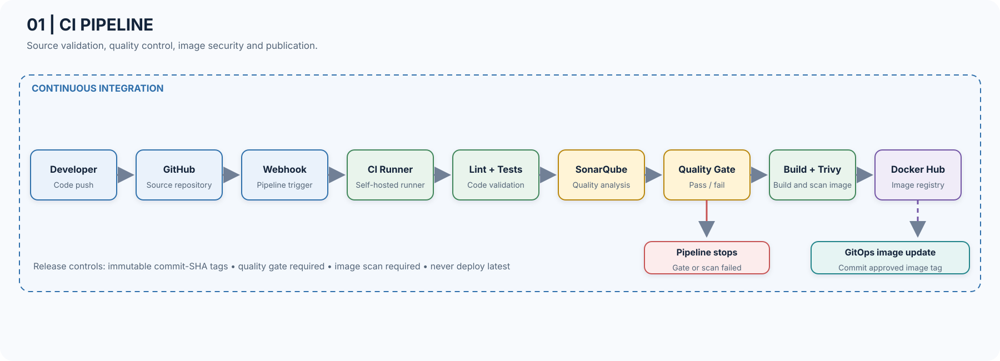
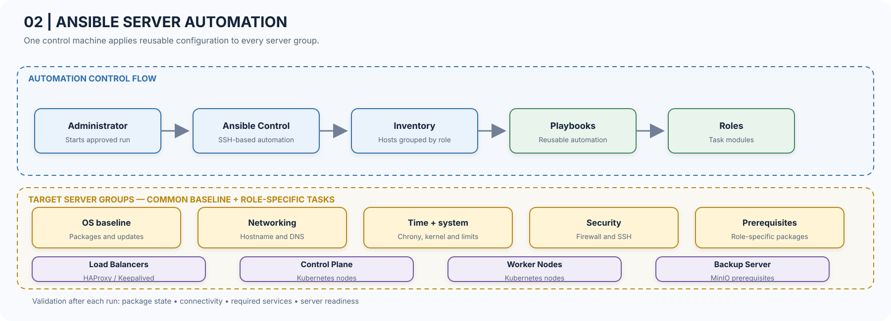
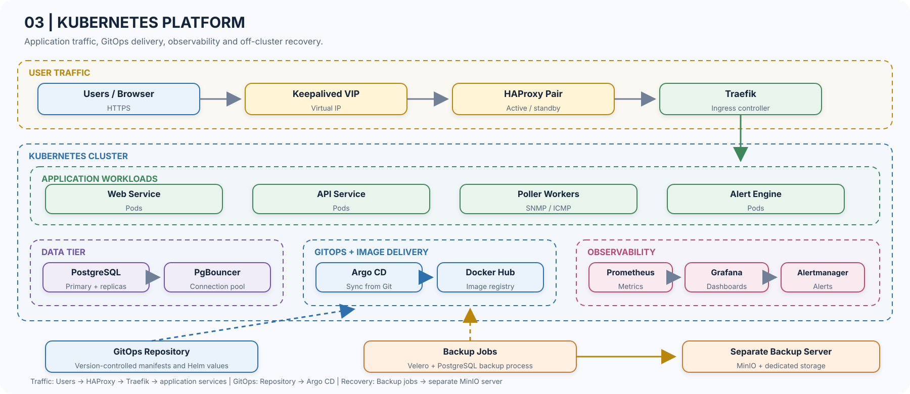

# NMS Platform — On-Premises Kubernetes Deployment

A production deployment blueprint for a microservices Network Management System (NMS) running on physical infrastructure.

**Platform:** Kubernetes · Ansible · HAProxy · Keepalived · Traefik · Argo CD · GitHub Actions · Docker Hub · Velero · MinIO · Prometheus · Grafana

---

## 1. CI Pipeline — Build, Validate and Publish

The CI pipeline validates application changes, builds container images, scans them and publishes approved images to Docker Hub.



**Pipeline controls**
- Run linting and unit tests before image creation.
- Enforce the SonarQube quality gate.
- Scan images with Trivy before publishing.
- Use immutable commit-SHA image tags; do not deploy `latest`.
- Publish approved images to Docker Hub.
- Update the GitOps repository with the approved image version.

## 2. Ansible Automation — Configure All Servers

Ansible is the configuration and installation layer for the physical servers. A central control machine connects to the server inventory and applies reusable playbooks and roles.



**Automation scope**
- Maintain an inventory grouped by server role.
- Apply common OS packages and baseline configuration.
- Configure hostnames, DNS, time synchronization and networking.
- Apply kernel parameters, firewall rules and SSH hardening.
- Install role-specific prerequisites and required packages.
- Validate connectivity, required services and server readiness.

**Suggested Ansible repository structure**

```text
infra-ansible/
├── inventory/
│   ├── production.ini
│   └── group_vars/
├── playbooks/
│   ├── site.yml
│   ├── common.yml
│   ├── loadbalancer.yml
│   ├── kubernetes.yml
│   └── backup.yml
└── roles/
    ├── common/
    ├── packages/
    ├── networking/
    ├── security/
    ├── loadbalancer/
    └── prerequisites/
```

## 3. Kubernetes Platform — Delivery, Monitoring and Backup

The Kubernetes cluster runs the NMS workloads and platform services. Traefik handles incoming application traffic, Argo CD reconciles the desired state from Git, and monitoring and backup components provide operational visibility and recovery.



| Area | Components | Purpose |
|---|---|---|
| Traffic entry | Keepalived · HAProxy · Traefik | Redundant access and application routing |
| Workloads | Kubernetes Deployments and Services | Run and expose NMS microservices |
| GitOps | Argo CD · Git repository | Reconcile cluster state from version-controlled manifests |
| Image registry | Docker Hub | Store and distribute container images |
| Monitoring | Prometheus · Grafana · Alertmanager | Metrics, dashboards and alerts |
| Backup | Velero · PostgreSQL backups · MinIO · cluster snapshots | Recovery outside the cluster |

## 4. High Availability, Backup and Security

**High availability**
- Two HAProxy nodes with a Keepalived Virtual IP.
- Multiple Kubernetes control-plane nodes.
- Multiple Traefik replicas distributed across worker nodes.
- Multiple application replicas with readiness and liveness probes.
- PostgreSQL primary and replicas with automated failover.
- PodDisruptionBudgets and topology spread constraints for critical workloads.

**Backup policy**

| Data | Method | Target schedule |
|---|---|---|
| Kubernetes resources and supported volumes | Velero | Daily; 30-day retention |
| PostgreSQL | WAL archive + base backup | Continuous WAL; daily base backup |
| Cluster state | Control-plane snapshots | Every 6 hours |

Store backups on a separate server. Test database and Kubernetes restores before go-live and monthly thereafter. Maintain an additional copy of critical backups on separate storage or at another site.

**Security baseline**
- Default-deny NetworkPolicies with explicit allowed traffic.
- Non-root containers and least-privilege RBAC.
- Trivy image scanning and controlled Docker Hub image pulls.
- Encrypted secrets; no plain secrets in Git.
- TLS for sensitive internal and external connections.
- Restricted backup credentials and synchronized time on all servers.

## 5. Implementation Sequence

1. Prepare physical servers and network using Ansible.
2. Configure DNS, time synchronization and certificate authority.
3. Deploy HAProxy and Keepalived.
4. Install and validate the Kubernetes cluster.
5. Deploy Traefik and secret management.
6. Configure Docker Hub access and the CI pipeline.
7. Deploy PostgreSQL and validate database recovery.
8. Deploy Velero and the separate backup server.
9. Deploy Prometheus, Grafana and Alertmanager.
10. Deploy Argo CD and connect the GitOps repository.
11. Deploy the application through the CI/CD workflow.
12. Complete production acceptance tests.

## 6. Go-Live Acceptance Checklist

- [ ] Delete an application Pod and confirm service continuity.
- [ ] Reboot a worker node and confirm workload recovery.
- [ ] Stop the active HAProxy node and verify Virtual IP failover.
- [ ] Stop one control-plane node and verify cluster availability.
- [ ] Fail the PostgreSQL primary and verify replica promotion.
- [ ] Verify HPA scale-out and scale-in under load.
- [ ] Restore PostgreSQL from backup into a test environment.
- [ ] Restore Kubernetes resources using Velero.
- [ ] Verify external alerting during a service outage.

---

**Operating principle:** Ansible standardizes server configuration. CI validates and publishes application images. Argo CD deploys the approved desired state. Monitoring detects issues, and off-cluster backups support recovery.
